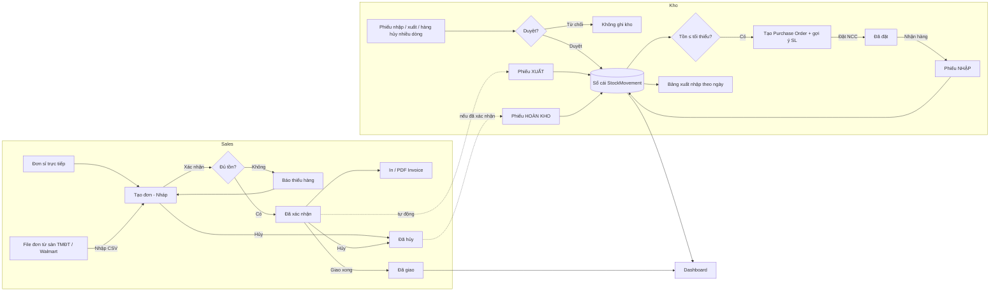
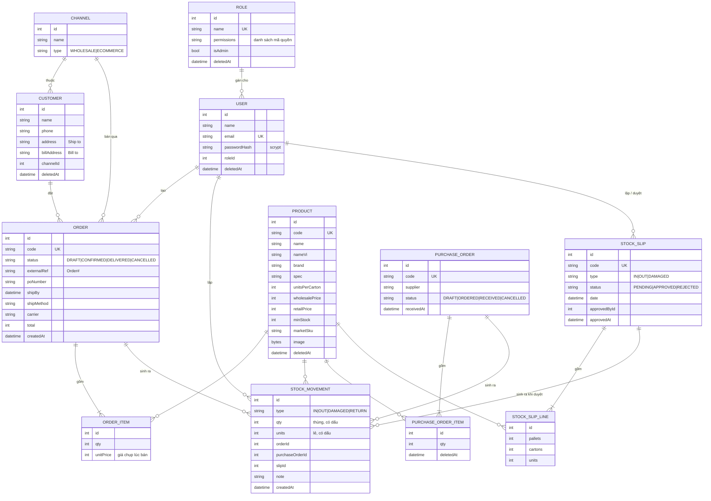

# Báo cáo dự án – LNS OMS (MVP 1.0)

**Ứng viên:** Trường Võ · **Vị trí:** Intern SWE 2026 – Sondoong Labs
**Demo:** `<link Vercel – cập nhật sau khi deploy>` · **Source:** `<link GitHub – cập nhật sau khi push>`

**Tài khoản demo** (mật khẩu chung `123456`):

| Email | Vai trò | Dùng để thử |
|---|---|---|
| `admin@demo.vn` | Quản trị | Toàn quyền, kể cả phân quyền |
| `sales@demo.vn` | Sales | Tạo đơn, khách hàng, nhập đơn từ sàn |
| `kho@demo.vn` | Kho | Sản phẩm, phiếu kho (lập + duyệt), đơn nhập hàng |

---

## 1. Tóm tắt

Doanh nghiệp bán sỉ thực phẩm đang quản lý đơn hàng bằng invoice rời, còn tồn kho nằm trong một file Excel cá nhân của nhân viên kho (mỗi ngày một cột) và phiếu nhập/xuất giấy. Phase 1 cần một **Order Management System** đủ để doanh nghiệp chạy UAT.

MVP 1.0 phủ trọn vòng nghiệp vụ:

> **Bán hàng** (sỉ trực tiếp + sàn TMĐT) → **Invoice** → **Xuất kho tự động** → **Cảnh báo hàng sắp hết** → **Đơn nhập hàng** → **Nhập kho** → **Dashboard**

| Module | Đã làm |
|---|---|
| Sản phẩm (catalogue) | Mã, tên tiếng Anh + tiếng Việt, thương hiệu, quy cách, đơn vị/thùng, giá sỉ, giá lẻ, tồn tối thiểu, **mã hàng trên sàn (SKU)**, **ảnh tải lên từ máy** |
| Khách hàng & kênh bán | Khách gắn với kênh (Sỉ trực tiếp, Shopee, Lazada, TikTok Shop, Walmart Marketplace); địa chỉ **giao hàng (Ship to)** và **xuất hoá đơn (Bill to)** riêng |
| Đơn hàng / Invoice | Đơn nhiều dòng, tự áp giá sỉ / lẻ theo kênh, vòng trạng thái Nháp → Xác nhận → Đã giao / Hủy. Đơn sàn lưu **Order#, Purchase order#, hạn giao (Ship by), phương thức và hãng vận chuyển**; đơn quá hạn được đánh dấu "Trễ". Invoice in / lưu PDF theo đúng mẫu của khách |
| Nhập đơn từ sàn | Nhận **file xuất gốc của Walmart Seller Center** (đọc theo tên cột, địa chỉ có dấu phẩy) và mẫu CSV đơn giản cho các sàn khác. Nhập lại không bị trùng |
| Kho | **Phiếu nhập / xuất / hàng hủy nhiều dòng** theo mẫu *Inventory In/Out Monitor* (pallet, thùng, đơn vị lẻ) có **bước duyệt**; tự trừ kho khi xác nhận đơn, tự hoàn kho khi hủy; thẻ kho theo sản phẩm; **bảng xuất nhập theo ngày** thay file Excel |
| Cảnh báo & đặt hàng | Sản phẩm dưới mức tối thiểu được đánh dấu; một nút tạo Purchase Order kèm **số lượng gợi ý**; nhận hàng thì tự cộng kho |
| Dashboard | Doanh thu 30 ngày theo kênh (kèm % đóng góp), top 5 sản phẩm bán chạy, đơn nháp / chờ giao, hàng sắp hết sắp theo mức nguy cấp |
| Đăng nhập & phân quyền | Email + mật khẩu, phiên bằng JWT. Admin tự tạo **vai trò gồm các quyền** rồi gán vai trò cho từng tài khoản |

## 2. Quyết định thiết kế quan trọng nhất: tồn kho là sổ cái, không phải một con số

File Excel hiện tại lưu **một ô "Inventory"** rồi sửa tay theo từng ngày. Vì vậy số tồn sai mà không ai biết sai từ đâu, và không truy vết được ai đã xuất cái gì.

Trong hệ thống này **không có cột "tồn kho"**. Mỗi thay đổi là một dòng `StockMovement` (nhập +, xuất −, hủy −, hoàn +) gắn với chứng từ gốc (đơn bán / đơn nhập / phiếu kho) và người lập.

```
Tồn (đơn vị) = Σ (thùng × đơn vị/thùng + lẻ)   theo sản phẩm
Tồn hiển thị = số thùng đầy  (+ số lẻ còn dư)
```

Lợi ích:
- Luôn đối soát được: mỗi con số tồn đều truy được về từng chứng từ.
- Lịch sử theo ngày của file Excel trở thành một **bảng sản phẩm × ngày** sinh ra từ sổ cái, không cần thêm cột mỗi ngày.
- Không thể "sửa tay cho khớp". Muốn điều chỉnh thì phải lập phiếu, ghi lý do và **được duyệt**.
- Hàng hủy là một loại phiếu riêng, nên báo cáo được tổn thất.
- Tính theo đơn vị nên xuất lẻ (mở thùng lấy vài gói) vẫn đúng.

**Quy tắc ghi kho:**
- **Đơn bán** chỉ trừ kho khi được **Xác nhận**, không trừ lúc còn Nháp. Khi xác nhận, hệ thống kiểm tra đủ tồn cho mọi dòng, rồi ghi trạng thái và các phiếu xuất trong **cùng một transaction**. Hủy một đơn đã xác nhận sẽ sinh phiếu hoàn kho, không xóa phiếu xuất cũ.
- **Phiếu kho tay** lập xong ở trạng thái *Chờ duyệt*; tồn chỉ đổi khi người có quyền **Duyệt phiếu kho** bấm duyệt (cũng kiểm tra tồn và ghi trong một transaction). Đúng với dòng *APPROVED BY* trên phiếu giấy.

## 3. Business flow



## 4. ERD



Ghi chú:
- `OrderItem.unitPrice` lưu **giá tại thời điểm bán**. Đổi giá catalogue sau đó không làm sai invoice cũ.
- Tiền lưu bằng **số nguyên (cent)** để không có sai số làm tròn của số thực.
- `Order.externalRef` là mã đơn trên sàn: dùng để đối soát và **chặn nhập trùng**. `Product.marketSku` là mã hàng trên sàn: dùng để khớp file Walmart và in cột *Item Number* trên invoice.
- **Xóa mềm** (`deletedAt`) cho sản phẩm, khách hàng, tài khoản, vai trò và dòng đơn nhập: dữ liệu bị ẩn đi nhưng đơn cũ, thẻ kho và lịch sử vẫn nguyên vẹn.
- Ảnh sản phẩm lưu thẳng trong DB (≤ 2MB), nên deploy lên Vercel không bị mất file.

## 5. Tech stack và lý do chọn

| Thành phần | Chọn | Lý do |
|---|---|---|
| Framework | **Next.js 15 (App Router) + TypeScript** | Một codebase cho cả UI và backend (Server Components + Server Actions + Route Handlers), không phải dựng API riêng. Type-safe từ DB lên UI. |
| ORM / DB | **Prisma + PostgreSQL** (dev: SQLite) | Dữ liệu ERP là dữ liệu quan hệ và cần transaction (xác nhận đơn + trừ kho, duyệt phiếu + ghi kho phải nguyên tử). Schema Prisma chính là ERD. |
| Gọi dữ liệu danh sách | **TanStack Query** + API `GET /api/<resource>` | Cache, giữ dữ liệu cũ khi chuyển trang (không nháy), tự làm mới sau khi lưu. Bộ lọc và phân trang nằm trên URL nên tải lại trang hay gửi link vẫn giữ nguyên. |
| Xác thực | **JWT HS256 trong cookie httpOnly**, mật khẩu băm **scrypt** | Viết bằng `node:crypto`, không thêm thư viện. Quyền đọc lại từ DB mỗi request nên đổi vai trò có hiệu lực ngay. |
| UI | **Tailwind CSS v4** | Làm nhanh; giao diện dạng bảng / sổ sách phù hợp người dùng quen Excel; responsive tới điện thoại. |
| Hosting | **Vercel + Postgres miễn phí (Neon/Supabase)** | Deploy từ Git trong một bước, chi phí 0đ cho giai đoạn UAT. |
| Invoice / phiếu kho PDF | **Trang in + "Lưu PDF" của trình duyệt** | Không thêm thư viện; ra đúng bản in giấy mà khách đang dùng. |

Không dùng NestJS hay microservice: với thời hạn 3 ngày, một monolith gọn là lựa chọn thực dụng. Ranh giới module (sản phẩm / đơn / kho / đơn nhập / người dùng) đã tách sẵn trong `src/lib/actions.ts` và `src/app/api`, nên khi cần có thể bóc thành service riêng.

## 6. Bảo mật & phân quyền

- **Ba lớp kiểm tra quyền:** trang (không có quyền xem → về Tổng quan kèm thông báo), API (thiếu token → 401, thiếu quyền → 403), và từng server action (ghi dữ liệu). Ẩn nút trên giao diện chỉ để gọn mắt, không phải lớp bảo vệ.
- **`GET /api/auth/me` (checkMe)** trả `{ code, success, result: { id, email, fullname, isAdmin, userRoles, userPermissions, tokenExpiresAt }, serverTime }`. Client gọi lại **mỗi lần chuyển trang** và đúng lúc token hết hạn; nhận 401 thì đưa về trang đăng nhập. Các nút thao tác ẩn / hiện theo `userPermissions`.
- **13 quyền chia theo module** (đơn hàng, khách hàng, sản phẩm, kho, đơn nhập, người dùng), ví dụ `orders.status`, `inventory.approve`. Admin tạo vai trò mới bằng cách tick quyền; vai trò *Quản trị* là vai trò hệ thống, luôn toàn quyền và không sửa / xóa được.
- Quy tắc an toàn: không tự đổi vai trò / tự xóa mình; chỉ Quản trị mới động vào tài khoản Quản trị; không xóa vai trò còn người dùng.
- Ảnh tải lên được kiểm tra theo **nội dung file** (JPEG/PNG/WebP), từ chối SVG; ảnh chỉ trả cho người đã đăng nhập.

## 7. Ý tưởng bổ sung (điểm cộng)

1. **Nhập đơn sàn bằng file xuất gốc.** Sàn nào cũng xuất được file đơn, nên cách này thực dụng hơn tích hợp API từng sàn. Hệ thống đọc thẳng file của Walmart Seller Center (khớp cột theo tên, khớp hàng theo SKU sàn), tự tạo khách mới kèm địa chỉ, **nhập lại không bị trùng**, đơn vào trạng thái Nháp để kiểm tra trước khi trừ kho.
2. **Gợi ý số lượng nhập hàng** dựa trên tốc độ bán 30 ngày: `max(bán 30 ngày + tồn tối thiểu − tồn hiện tại, 2 × tối thiểu − tồn)`. Nhân viên kho không phải tự ước lượng, và vẫn sửa được số trước khi đặt.
3. **Phiếu kho có duyệt** đúng mẫu giấy *Inventory In/Out Monitor*: lập nhiều dòng một lần, in ra giống hệt bản giấy, tồn chỉ đổi khi được duyệt.
4. **Bảng xuất nhập theo ngày** giữ đúng thói quen đọc Excel của kho (sản phẩm × ngày, cột hàng hủy) nhưng sinh tự động từ sổ cái, không ai phải gõ tay.
5. **Cảnh báo sớm:** form tạo đơn báo ngay khi số lượng vượt tồn; danh sách đơn đánh dấu đơn sàn sắp / đã trễ hạn giao.
6. **Vai trò tự định nghĩa:** doanh nghiệp tự tạo vai trò mới (ví dụ *Kế toán* chỉ xem) mà không cần sửa code.

## 8. Giả định và phạm vi

**Giả định**
- Đơn vị bán và tồn kho chính là **thùng (carton)**; phiếu kho ghi thêm được pallet (nhập) và đơn vị lẻ (xuất).
- Một kho duy nhất, một loại tiền (USD, theo catalogue mẫu).
- Giá lẻ (dùng cho kênh sàn) mặc định bằng giá sỉ + 20% và sửa được.
- Hủy đơn chỉ áp dụng trước khi giao; trả hàng sau giao để Phase 2.

**Để Phase 2**
- Tích hợp API sàn (Shopee/Lazada/TikTok/Walmart) để đồng bộ đơn và trạng thái tự động.
- Quản lý **lô và hạn sử dụng (FEFO)** cho kem, nước giải khát; cảnh báo hàng sắp hết hạn.
- Trả hàng / credit note, công nợ khách sỉ, thanh toán.
- Nhiều kho, chuyển kho; kiểm kê định kỳ.
- Danh mục nhà cung cấp và giá nhập để tính lãi gộp.
- Thu hồi token khi đăng xuất, giới hạn số lần đăng nhập sai.

## 9. Kịch bản UAT gợi ý (khoảng 7 phút)

1. Đăng nhập `sales@demo.vn` → **Đơn hàng → Tạo đơn** cho "Đại lý Minh Phát", 2 dòng hàng → Lưu (Nháp).
2. Bấm **Xác nhận** → mục "Phiếu kho liên quan" hiện phiếu xuất; mở **Kho**, số tồn đã giảm. Bấm **In hoá đơn**.
3. **Nhập đơn từ sàn** với nội dung mẫu có sẵn → được các đơn nháp. Nhập lại → 0 đơn mới, các đơn cũ bị bỏ qua.
4. Đăng nhập `kho@demo.vn` → **Kho → Lập phiếu kho**: phiếu nhập 2 dòng (pallet + thùng) → Lưu (Chờ duyệt, tồn chưa đổi) → **Duyệt & ghi kho** → tồn tăng. Bấm **In / Lưu PDF** để xem bản theo mẫu giấy.
5. **Kho → Bảng theo ngày**: thấy cột hôm nay có số vừa nhập.
6. **Tổng quan** thấy "Hàng sắp hết" → **Đơn nhập hàng** → *Tạo 1 đơn nhập cho tất cả* → chỉnh số lượng → Đặt NCC → **Đã nhận hàng** → tồn được cộng và cảnh báo biến mất.
7. Đăng nhập `admin@demo.vn` → **Phân quyền → Vai trò**: bỏ quyền "Sản phẩm: Xem" của vai trò *Sales* → đăng nhập lại bằng Sales: menu Sản phẩm biến mất, mở thẳng `/products` bị chặn.

## 10. Ảnh chụp màn hình

`<chèn ảnh: Đăng nhập, Tổng quan, Tạo đơn, Chi tiết đơn, Invoice, Kho – Bảng theo ngày, Phiếu kho (bản in), Phân quyền>`
